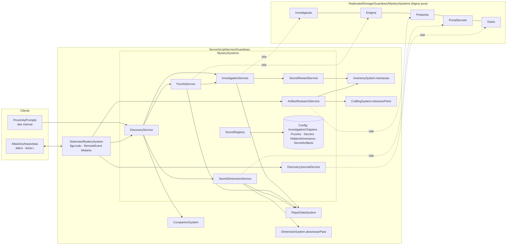

# 29 · Sistema de mistérios: Atlas dos Arquivistas (complemento 03)

Data: 19/11/2026. **Nada foi executado** no Studio nem em runtime Luau (o Lune continua bloqueado aqui).

Este é o terceiro complemento. Ele **não substitui** o GDD, o complemento de criaturas, voo e artefatos, nem o segredo ??? do Ato 1 (`SecretDiscoverySystem`). A dependência de cada peça está no doc 28; a lore está em [lore/ARQUIVISTAS.md](lore/ARQUIVISTAS.md).

## 1. Planejado × codificado × testado

| Item do complemento | Planejado | Codificado | Testado |
|---|---|---|---|
| Fase A: auditoria | ✔ | — | — (doc 28) |
| Fase B: arquitetura, contratos, dados | ✔ | ✔ | Static check |
| Fase C: investigação com 3 pistas e conclusão validada | ✔ | ✔ | Spec (lógica pura); **Studio: não** |
| Fase D: diário com só o autorizado | ✔ | ✔ | Spec (montagem); **interface: não** |
| Fase E: enigma de sequência validado no servidor | ✔ | ✔ (e os outros 6 tipos) | Spec; **Studio: não** |
| Fase F: item de teste na bolsa | ✔ | ✔ (Folha de Registro) | **Studio: não** |
| Fase G: criatura investigativa | ✔ | ✔ (detecção + reação + alternativas) | **Studio: não** |
| Fase H: receita secreta de teste persistente | ✔ | ✔ (Tinta do Arquivista) | Spec (regras); **Studio: não** |
| Fase I: portais secretos | ✔ | ✔ (estados, descoberta; viagem pelo DimensionSystem) | Spec; **teleporte real: impossível sem place** |
| Fase J: testes | ✔ | 21 casos automáticos + roteiros M1 a M18 | **Não rodaram** |
| Fase K: expansão | ✔ | — | — (seção 10) |
| Capítulos 2 e 3 | ✔ | ✔ (doc 30) | Spec; **Studio: não** |
| Capítulo 4 | ✔ | ✔ (doc 31) | Spec; **Studio: não** |
| Capítulos 5 a 7, 4 dimensões ocultas, 3 artefatos ??? jogáveis | ✔ | Dados; **sem conteúdo jogável** | — |

## 2. Diagrama de arquitetura



**Regras da arquitetura:**
- **Sem dependência circular:** os serviços **não dão `require` uns nos outros**. Recebem uma tabela `deps` montada pelo `MysterySystem`.
- **Configs:** só o `SecretRegistry` lê as configs, e as confere na partida. Uma entrada com erro é desligada com aviso, sem derrubar o servidor.
- **Lógica pura:** a lógica das regras é pura (sem API do Roblox) e testável fora do Studio. As soluções nunca ficam nela: ficam nas configs do servidor.

## 3. Diretórios

```
src/ReplicatedStorage/Guardioes/MysterySystems/      lógica pura (sem segredos)
  Investigacao.luau   estados, pistas, objetivos, capítulos, validação
  Enigma.luau         motor universal: Sequencia, Alinhamento, Coleta, Ressonancia, Exploracao, Cooperativo, Interdimensional
  Pesquisa.luau       7 etapas da pesquisa e regra de fabricação secreta
  PortalSecreto.luau  oculto → selado → aberto; nunca viaja sem place
  Diario.luau         monta o diário só com o descoberto
src/ServerScriptService/Guardioes/MysterySystems/    SÓ SERVIDOR
  SecretRegistry · DiscoveryService · InvestigationService · PuzzleService · SecretDimensionService
  ArtifactResearchService · DiscoveryJournalService · SecretRewardService
  Config/ InvestigationChapters · Puzzles · Secrets · HiddenDimensions · SecretArtifacts
src/ServerScriptService/Guardioes/Sistemas/MysterySystem.luau      entrada (Main.server)
src/StarterPlayer/.../Controladores/AtlasDosArquivistas.luau        diário (Main.client)
docs/lore/ARQUIVISTAS.md                                             cânone versionado
```

## 4. Modelos de dados

**Perfil:** `perfil.misterios`, versão 1. A migração completa os subcampos que faltarem.

```lua
misterios = {
  versao = 1,
  investigacoes = { [invId] = { estado, capitulo, pistas = {[id]=true}, objetivos = {[id]=true},
                                 capitulosConcluidos = {["1"]=true}, versaoConteudo } },
  enigmas = { [puzzleId] = true },        -- resolvidos (persistente)
  recompensas = { [recId] = true },       -- já pagas: NUNCA pagam duas vezes
  registros = {}, conhecimentos = {}, receitas = {},   -- desbloqueios
  portais = { [portalId] = "descoberto" },  -- "aberto" é calculado, nunca salvo
  fabricados = { [receitaId] = n }, evolucoes = {},
}
```

**Investigação** (`Config/InvestigationChapters`):
- Campos gerais: id estável, `nome`, `descricao`, `dimensao`, `categoria` (A a E), `versaoConteudo`, `requer` (outras investigações) e `descobertaPor`.
- `capitulos[n]`: `{ lancado, pistas = {[id] = { nome, texto com {1}{2}{3}, capacidade? }}, objetivos, recompensa }`.
- Os estados vão de **Undiscovered** a **Completed**.
- **Completed** exige todos os capítulos concluídos, e um capítulo não lançado nunca conclui. Isso é conferido por `Investigacao.validar` **antes de cada gravação**.

**Enigma** (`Config/Puzzles`):
- Campos: `PuzzleId` (a chave), `tipo`, configuração do tipo, `escopo` (individual ou cooperativo), `raio` e `objetivo` (investigação e objetivo).
- **Pré-requisito:** o objetivo precisa estar visível, ou seja, as pistas reunidas.
- **Reinício:** errar recomeça (`reiniciarAoErrar`). No cooperativo, passar da janela de tempo recomeça.

**Marca** (`Secrets.marcas`): `{ tipo = "pista" | "enigma" | "portal", ... }`, ligada a uma Part com o atributo `GuardioesMisterio`.

**Capacidade investigativa** (`Secrets.capacidades`): `{ nome, alcance, recarga, animacao, efeito, fontes = { companheiro, livros, equipamentos } }`.

**Passagem secreta** (`HiddenDimensions.portais`): `{ PortalId, origem, destino, descoberta, condicoes, grupo = {min,max}, retorno }`.

## 5. Primeiro protótipo: "O Segredo do Primeiro Arquivista", capítulo 1

Fica numa **sala de teste abstrata**: blocos neutros longe da arena, sem tocar em nenhum mapa.

1. **Inscrição:** ler a inscrição **descobre** a investigação. Ela diz qual marco vem primeiro **para este jogador**.
2. **Símbolo oculto:** pede **Percepção energética**. Qualquer uma destas fontes serve:
   - Axolote (Faro de Cristal) ou Lebre adulta (Trilha Escondida) **ativos e perto**;
   - **ou** o Grimório dos Céus lido;
   - **ou** o Amuleto Espectral equipado.

   A criatura **reage** (aviso e brilho) quando passa perto.
3. **Folha de diário:** diz qual marco vem por último.
4. **Estado:** com as 3 pistas, a investigação fica **pronta para resolver** e o objetivo "Ativar os três marcos" aparece.
5. **Marcos:** tocar os 3 na ordem. Errar apaga todos. O servidor confere distância, frequência, se as pistas já foram reunidas e a ordem do jogador.
6. **Conclusão:** o capítulo 1 conclui e paga, **uma vez só, numa gravação só**:
   - Folha de Registro;
   - o registro de lore `Arq01_OSinal`;
   - o conhecimento "Leitura de sinais";
   - a **receita secreta Tinta do Arquivista**;
   - 150 XP.
7. **Fabricação:** a Tinta é fabricada na Bancada pelo diário. Sem a receita, nem com todos os materiais.
8. **Depois do capítulo 1:** a investigação fica "Investigando" e o capítulo 2 aparece como "ainda não disponível".
9. **Porta sem moldura:** examiná-la registra a passagem para a Biblioteca do Vazio. Ela fica **selada** (exige o capítulo 6), e mesmo aberta responderia "em construção".

**Reentrada segura:**
- Pistas, enigma resolvido e recompensas ficam salvos.
- Uma sequência pela metade **recomeça**, de propósito: nada é pago pela metade.
- Se o servidor cair entre concluir o capítulo e pagar, o `InvestigationService.reconciliar` paga ao entrar de novo, uma vez só.

## 6. Interface conceitual do diário (Atlas dos Arquivistas)

- **Como abrir:** tecla **L**, a aba "Atlas" ou toque.
- **Tamanho:** no celular ocupa 92% da largura; no computador tem no máximo 400 × 520. A rolagem é vertical e os botões têm 34 px de altura, para o toque.
- **Seções, só com o que existe para o jogador:**
  - investigações, com estado, capítulo atual, objetivos visíveis, pistas com o texto já preenchido e capítulos ainda por vir;
  - registros;
  - conhecimentos;
  - receitas reveladas, com o botão Fabricar;
  - pesquisas (etapas já alcançadas; as futuras como "???");
  - passagens (aberta ou selada).
- **O que nunca vai para o cliente:** investigação não descoberta, nome de capítulo futuro, ordem de enigma, condições de portal, ids de enigma e receitas não reveladas.

## 7. Os três artefatos ??? (`Config/SecretArtifacts`)

Usam a **mesma** arquitetura metamórfica: formas, estágios e transformação. São **adicionais** e não substituem a Espada do Horizonte, o Escudo do Firmamento, o Cajado dos Ventos Antigos nem o Arco.

| Artefato | Formas | Mecânica exclusiva | Pesquisa (7 etapas) começa em |
|---|---|---|---|
| **Lâmina do Não-Existente** | Lâmina · **Prancha astral** (velocidade 44) | Corte Entre Mundos: o golpe pesado ignora parte da **postura** a cada 12 s | Capítulo 4 |
| **Escudo do Último Arquivista** | Escudo · **Plataforma flutuante** | Barreira do Arquivo: aliados próximos com 40% menos dano por 3 s | Capítulo 6 |
| **Cajado da Fratura** | Cajado · **Passo da Fratura** (deslocamento) | Percepção da Fratura: conta como Visão Arcana e Ressonância Dimensional | Capítulo 7 |

**Regras dos artefatos ???:**
- **Ordem das raridades:** a ??? (multiplicador 1,56) continua acima da Arcano (1,50). A ordem não mudou.
- **Velocidade:** nenhum passa da velocidade do Arco (46); o spec confere.
- **De onde vêm:** minibosses continuam dando Druida e Guardiões continuam dando Arcano. Os ??? vêm **só** de investigação, nunca de sorte ou compra.
- **Estado:** **definidos, mas não registrados** no `MetamorphicArtifactSystem`, porque as pesquisas dependem de capítulos não lançados. Registrar exige também as armas (Config/Armas) e os perfis de voo; isso é o primeiro passo quando o capítulo 4 for feito.

## 8. Integração com as mecânicas anteriores (seção 13)

| Mecânica | Como entra | Estado |
|---|---|---|
| Combate | Inimigos protegendo marcas: surgimento normal do `EnemySystem` perto delas | Planejado |
| Companheiros | Capacidades leem as habilidades das espécies; criatura reage a marcas | **Codificado** |
| Vínculo Dimensional | `habilidadesEfetivas` já inclui as afinidades: uma afinidade pode dar a habilidade que conta | Codificado (por tabela) |
| Livros mágicos | Livro lido é fonte de capacidade | **Codificado** |
| Voo e montarias | Enigma de Exploração (área alcançada, medida pelo servidor) | Motor pronto; sem lugar no mapa |
| Artefatos metamórficos | Forma ativa como fonte de capacidade (ex.: Cajado da Fratura) | Planejado |
| Restauração | Condição de portal ou pista: estrutura restaurada | Planejado (interface `restaurada`) |
| Companhias | Enigmas cooperativos opcionais (tipo Cooperativo) | Motor pronto; recompensa individual conferida |
| Fabricação | Receitas secretas com estação da base | **Codificado** |
| Progressão | XP da recompensa; tudo salvo no perfil | **Codificado** |

**Nenhum segredo essencial** depende de raça, companhia ou espécie. Toda capacidade tem pelo menos 2 tipos de fonte, e o spec confere.

## 9. Plano de testes

- **Unitários (21 casos):**

  | Spec | Casos | O que cobre |
  |---|---|---|
  | `Investigacao.spec` | 6 | Estados, capítulos futuros, validação, diário filtrado |
  | `Enigma.spec` | 7 | Os 7 tipos, sementes, configs reais |
  | `Misterios.spec` | 8 | Fabricação secreta, pesquisa, portais, dimensões, artefatos, capacidades, recompensas, perfil |

- **Integração, segurança, salvamento e multiplayer:** roteiros **M1 a M18** em `10-TESTES-COMPLEMENTO.md`, seção 20.

## 10. Expansão (fase K) e o que não foi implementado

**Próximos passos, nesta ordem e com a sua aprovação:**
1. Capítulo 2 (o Guardião Adormecido): criatura pacífica e alternativa por habilidade.
2. Capítulo 3: as três torres, usando restauração.
3. Capítulo 4: a chave incompleta, com o primeiro artefato ??? registrado.
4. Capítulo 5: quando o Campo das Bolhas for liberado.
5. Biblioteca do Vazio: o primeiro mapa secreto real.
6. Capítulos 6 e 7.

**Não implementado nesta etapa (de propósito):**
- capítulos 2 a 7;
- os mapas das 4 dimensões ocultas;
- os artefatos ??? jogáveis (armas, perfis, registro);
- enigmas dos tipos Alinhamento, Coleta, Ressonância, Exploração, Cooperativo e Interdimensional **colocados no mapa** (o motor e as configs de exemplo existem);
- efeitos visuais e animações das criaturas reagindo (só aviso e brilho simples);
- viagem em grupo pelas passagens.

**Limitações conhecidas:**
- **Nada rodou:** nem no Studio nem no Lune.
- **Sequências pela metade** não ficam salvas.
- **A reação da criatura** só acontece uma vez por marca por sessão.
- **Texto da pista:** se a ordem do enigma mudar numa atualização, o texto já lido muda junto (é gerado da semente). Para evitar, nunca mude `elementos` de um enigma publicado: crie outro.
